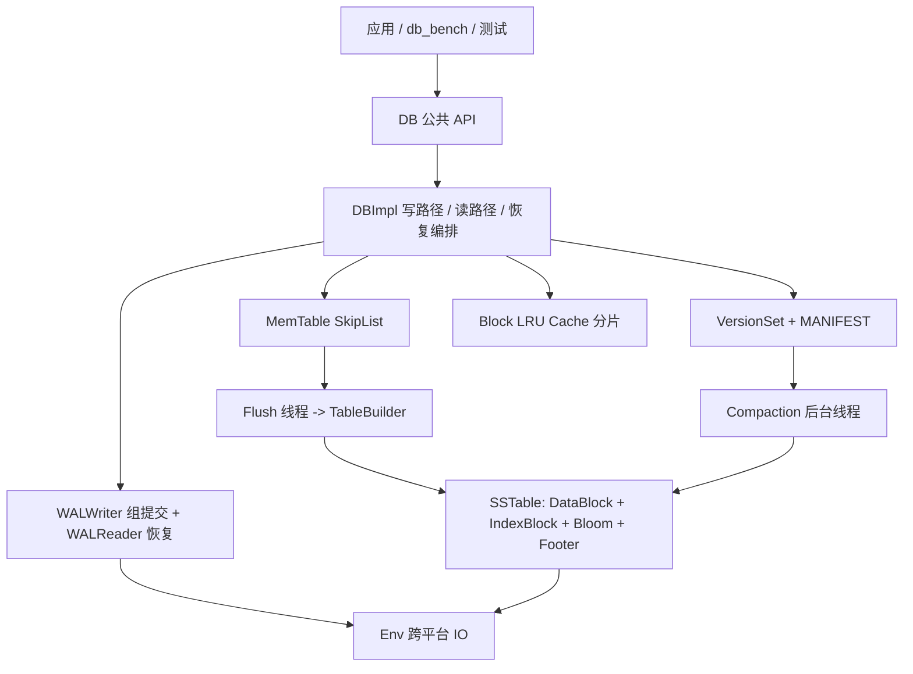

# Kestrel

一个从零手写的嵌入式持久化 KV 存储引擎（C++17，约 6000 行，零第三方运行时依赖）。
定位是"能自证正确性、能量化性能"的 LSM-Tree 存储引擎：WAL 组提交 + SkipList MemTable +
SSTable（前缀压缩/重启点/布隆过滤器）+ MANIFEST + 分层 Compaction + Block LRU 缓存。

它**不是**又一个 WebServer 或 Redis 复刻：没有网络层、没有分布式、没有事务，
只有一个进程内的 `Put / Get / Delete`，但每一个写入语义和每一个性能数字都有对应的
测试或基准在仓库里跑得出来。

## 已实现的能力

| 层次 | 内容 |
| --- | --- |
| 公共接口 | `DB::Open / Put / Get / Delete / GetSnapshot / ReleaseSnapshot / Flush / CompactRange / GetProperty`，错误统一走 `Status`（`NotFound / Corruption / IOError / InvalidArgument`），不用异常做控制流 |
| 写路径 | 写队列 + leader 批处理（一次分配 seq、一次 WAL 追加、一次 fsync）+ `crc32c` 校验，返回 OK 即已 `fsync` |
| 内存层 | SkipList MemTable（单写多读、`memory_order_release/acquire` 发布节点指针），按 `write_buffer_size` 冻结换出 |
| 磁盘层 | SSTable：数据块（前缀压缩 + 每 16 条重启点）、索引块、布隆过滤器（10 bit/key，7 个探测）、48 字节 Footer |
| 元数据 | `MANIFEST` 全量快照重写 + `VersionSet` 分层视图，`*.tmp` 落盘后 rename + fsync 目录 |
| 读路径 | 内部键 `user_key + (seq<<8\|type)`、MVCC 快照读、墓碑语义、L0 新到旧扫描、L1+ 范围过滤 |
| Compaction | 后台线程、L0 文件数或层容量触发、单线程串行合并、按最小快照裁剪旧版本 |
| 缓存 | 分片 LRU（16 片、按字节计量、缓存块原始字节而非 `Block` 对象） |
| 可观测性 | 写放大、缓存命中率、flush/compaction 次数、组提交批大小，全部经 `GetProperty` 导出 |
| 工程化 | CMake + CTest、11 个测试目标、故障注入工具 `crash_test`、基准工具 `db_bench`、自研 150 行测试框架 |

## 快速开始

```bash
# Linux / WSL（本文档所有实测数据的运行环境）
cmake -S . -B build -G Ninja -DCMAKE_BUILD_TYPE=RelWithDebInfo
cmake --build build -j
cd build && ctest --output-on-failure

# 跑基准，结果写到 docs/bench_ext4.csv
bash benches/run_all.sh
```

```powershell
# Windows 原生（MSVC）：在 "Developer PowerShell for VS" 里执行，11 个测试全绿
cmake -S . -B build-msvc -G "Visual Studio 17 2022" -A x64
cmake --build build-msvc --config RelWithDebInfo -j
cd build-msvc; ctest -C RelWithDebInfo --output-on-failure

# 或在 Windows 一键转进 WSL(Ubuntu) 跑基准
powershell -File benches\run_all.ps1
```

最小使用示例：

```cpp
#include "kestrel/db.h"

kestrel::DB* db = nullptr;
kestrel::Options options;
kestrel::Status s = kestrel::DB::Open(options, "/tmp/demo", &db);
if (!s.ok()) return 1;

db->Put(kestrel::WriteOptions(), "user:1001", "kestrel");   // 返回即已落盘
std::string value;
s = db->Get(kestrel::ReadOptions(), "user:1001", &value);    // s.ok() / s.IsNotFound()

const kestrel::Snapshot* snap = db->GetSnapshot();           // 冻结一个读视图
db->Put(kestrel::WriteOptions(), "user:1001", "changed");
db->Get(kestrel::ReadOptions{snap->sequence}, "user:1001", &value);  // 仍读到 "kestrel"
db->ReleaseSnapshot(snap);

delete db;
```

## 架构



写：`Put` → 入写队列 → leader 一次取整批 → 分配 seq → 插 MemTable → 一次 WAL 追加(含 fsync)
→ 超阈值则 `Flush` 成 L0 → 记账 MANIFEST → 按需触发 Compaction。

读：`Get` → MemTable → L0（新到旧）→ L1..L6（层内范围过滤 + 布隆过滤器），
命中墓碑立即 `NotFound`，不会继续往下读到被删除的旧值。

恢复：读 MANIFEST 重建分层视图 → 按文件号装载 SSTable → 重放 WAL 到最后一个 CRC 合法的记录
→ 截断尾部垃圾 → 用新编号接续写日志。

## 关键设计取舍

1. **组提交而非每写一次 fsync**：并发写在一个队列里被 leader 合并，N 条记录只付一次
   `fsync`。批大小是可观测的（`kestrel.write_batch_avg`），不是"设计上支持"而已。
2. **follower 先自旋再阻塞**：批处理只有几微秒，为此陷入内核再被唤醒的往返比批处理本身还贵。
   实测本机唤醒延迟 50~120µs，自旋窗口把并发写从"4 线程比单线程慢 3 倍"救回正扩展。
3. **CRC 放在 WAL 记录头部**：先读长度并校验上界再分配内存，损坏的 length 字段不会变成 OOM 或越界。
4. **内部键 = user_key + (seq 降序)**：同一 key 的多版本天然按新到旧排列，
   "第一个 `seq <= snapshot` 的版本"就是可见版本，墓碑和快照读共用同一套判断。
5. **MANIFEST 用全量快照而不是增量 VersionEdit**：写代价 O(文件数)（几十行文本），
   换掉 VersionEdit 编解码 + 重放状态机这一整块容易出错的东西。
6. **Compaction 串行 + 全层合并**：同一时刻只允许一个合并，不持数据库主锁做归并，
   提交时短暂拿锁换元数据。不做 key 范围裁剪，牺牲写放大换实现正确性。

## 实测数据（AMD Ryzen 7 7735H / 16 核 / WSL2 / ext4，详见 [docs/BENCHMARKS.md](docs/BENCHMARKS.md)）

本机一次 `write(128B) + fsync` 实测 **1.36 ms**，所以同步写完全由 fsync 主导，
这也是组提交唯一能显著改善的场景。

| 场景 | 1 线程 | 4 线程 | 8 线程 |
| --- | --- | --- | --- |
| 顺序写（同步写，ops/s） | 752 | 1,046 | **2,425** |
| 随机写（同步写，ops/s） | 754 | 1,039 | – |
| 点查命中（ops/s） | 112k | 390k | **700k** |
| 点查未命中（ops/s） | 3.35M | 4.52M | – |
| 组提交平均批大小 | 1.00 | 1.41 | **3.35** |

- 顺序写 8 线程 **3.2x**：2,425 ops/s ÷ 3.35 条每批 ≈ 724 次 fsync/s × 1.38 ms —— 写吞吐就是 fsync 次数，批越大吞吐越高。
- 10 万条记录重启恢复（重放 WAL）：**8.0 ms**（约 1300 万条/秒）
- 10 万条写入后写放大：**1.64x**；块缓存命中率：**0.97**
- 强杀故障注入 100 轮、694,759 条已 ACK 写入：**0 丢失、0 值错误**

## 正确性怎么保证

- `test_recovery`：WAL 尾部截断、字节翻转、SSTable 损坏、孤儿 `.sst` 文件四种故障下，
  恢复必须成功、可见数据必须是写入序列的**前缀**、已有值不得读错。
- `crash_test`：子进程持续写入，父进程在随机时刻 `SIGKILL`，重启后逐条核对所有
  已 ACK 的 key（"宁 NotFound，不可读错值"）。
- `test_db`：与 `std::map` 基线对拍、快照隔离、Flush/Compaction 前后数据一致。
- 全部测试在 ASan + UBSan 与 TSan 下各跑一遍。

## 已知边界（不假装已实现）

- **没有公开迭代器**：只支持点查（`Get`）与快照点查，没有 `NewIterator`/前缀扫描，
  因此也没有交互式 CLI。
- **性能数字只在 Linux 上测过**：Win32 `Env` 已完整实现（`CreateFileW` + `WriteFile` +
  `FlushFileBuffers` + `MoveFileEx`），Windows 原生 11 个测试全绿；但本文档的吞吐/延迟
  仍全部来自 WSL2 + ext4，`FlushFileBuffers` 与 `fsync` 的实现路径不同，跨平台不能直接比。
- 单机单进程：没有多进程互斥锁（同一目录被两个进程打开会互相破坏）。
- Compaction 不做并发合并、不做 key 范围裁剪；L0 触发时全量合并。

## 目录结构

```
include/kestrel/     db.h options.h status.h slice.h     公共接口
src/db/             db_impl.* dbformat.* version.*       编排、内部键、版本视图
src/wal/            wal_writer.* wal_reader.* log_format.h   组提交与重放
src/memtable/       skiplist.* memtable.*
src/sstable/        block.* table_builder.* table_reader.* bloom_filter.* format.*
src/compaction/     compactor.*
src/cache/          lru_cache.*
src/util/           env.* coding.* crc32c.* comparator.* logger.*
tools/              db_bench.cpp crash_test.cpp
tests/              minitest.h + 8 个测试目标
benches/            run_all.sh run_all.ps1
docs/               DESIGN.md BENCHMARKS.md INTERVIEW.md bench_*.csv
```

## 文档

- [docs/DESIGN.md](docs/DESIGN.md)：WAL / SSTable / MANIFEST 的字节布局、读写恢复流程、锁序
- [docs/BENCHMARKS.md](docs/BENCHMARKS.md)：测试环境、方法、全部原始数据与结论
- [docs/INTERVIEW.md](docs/INTERVIEW.md)：20 道高频追问与回答（含本项目取舍）

学习材料（第 0~4 周、功能说明、学习手册）已集中到工作空间根目录的 `learning/kestrel/`：

- [learning/kestrel/week0.md](../../learning/kestrel/week0.md)：**读 week1 之前先看这份**——零基础补课，把术语、七个部件、读写与恢复路径讲透
- [learning/kestrel/week1.md](../../learning/kestrel/week1.md)：四周学习材料（原理、代码导读、动手任务）
